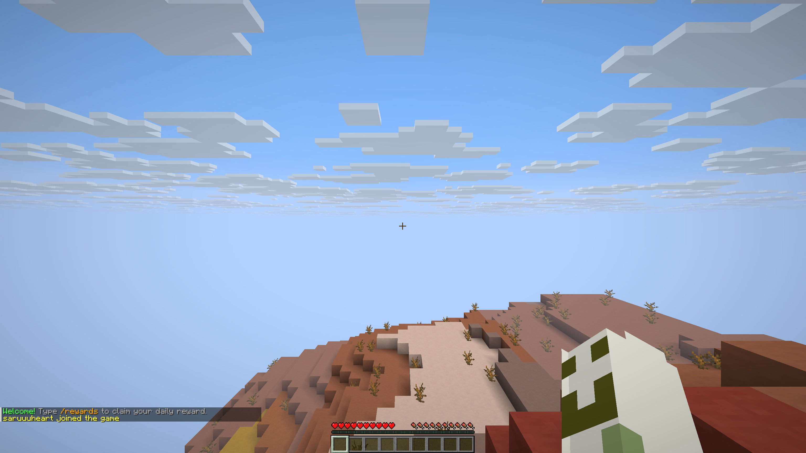
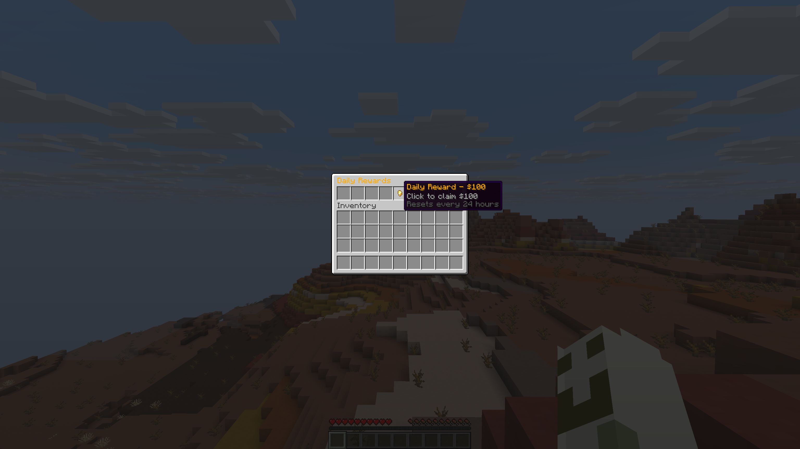
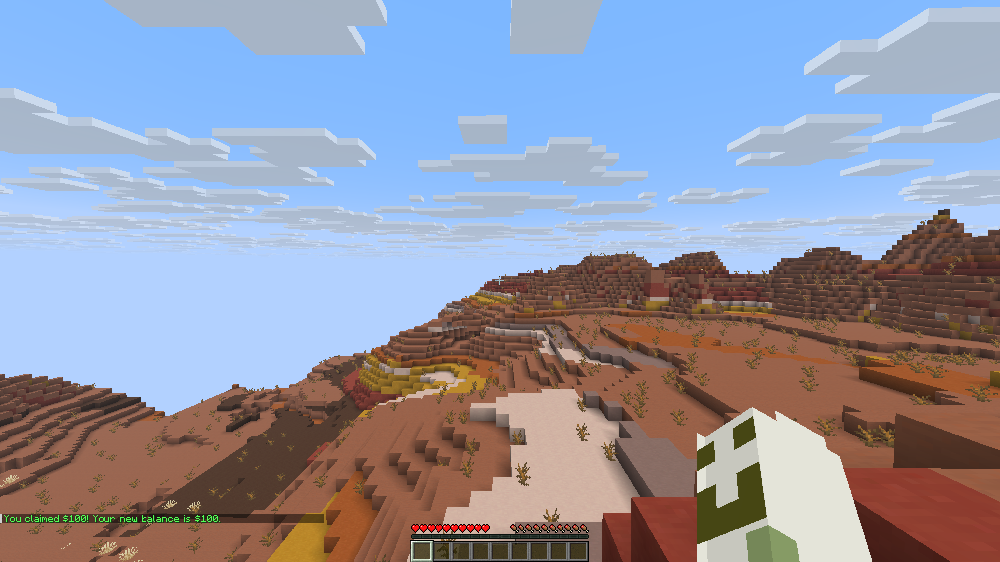
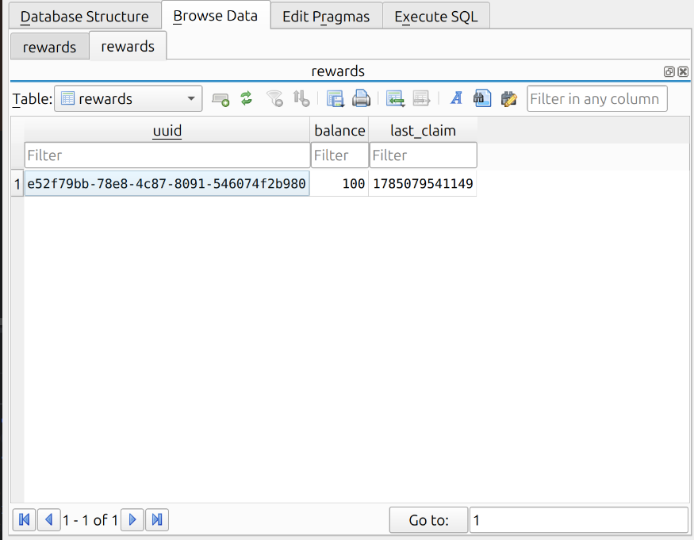

# 🎁 DailyRewards — Paper Minecraft Plugin


**DailyRewards** is a high-performance Minecraft: Java Edition plugin built for [Paper](https://papermc.io/). It provides players with a daily reward system featuring an interactive custom chest GUI, economy addition, and persistent SQLite data tracking with a strict 24-hour cooldown mechanism.

---

## 📸 Screenshots

| Feature | Preview |
|---|---|
| **Join Reminder Message** |  |
| **Interactive GUI (`/rewards`)** |  |
| **Reward Claiming & Balance** |  |
| **SQLite Database Sync** |  |

---

## ✨ Features

- 🎮 **Custom GUI Interface**: Run `/rewards` to open a clean 9-slot chest inventory with custom-styled items and lore.
- ⏰ **24-Hour Cooldown Enforcement**: Prevents players from spamming rewards; calculates exact remaining cooldown time before allowing another claim.
- 💰 **In-Game Economy Integration**: Awards $100 currency per claim directly to the player's balance.
- 💾 **SQLite Database Persistence**: Stores each player's UUID, balance, and claim timestamps locally (`plugins/DailyRewards/database.db`).
- ⚡ **Lightweight & Dependency-Free**: Uses Paper's built-in SQLite JDBC driver—no external dependencies or database installation required.
- 🔔 **Player Join Listener**: Automatically greets players upon joining and notifies them if their daily reward is ready to claim.

---

## 🛠️ Tech Stack

- **Language**: Java 25
- **API**: Paper API `26.2`
- **Database**: SQLite (JDBC)
- **Build System**: Gradle (Kotlin DSL) with `xyz.jpenilla.run-paper` plugin

---

## 💻 Commands & Permissions

| Command | Usage | Description | Permission |
|---|---|---|---|
| `/rewards` | `/rewards` | Opens the Daily Rewards GUI | Default (All Players) |

---

## 🗄️ Database Schema

The SQLite database (`database.db`) automatically initializes the `rewards` table on plugin startup:

```sql
CREATE TABLE IF NOT EXISTS rewards (
    uuid TEXT PRIMARY KEY,
    balance INTEGER NOT NULL DEFAULT 0,
    last_claim INTEGER NOT NULL DEFAULT 0
);
```

---

## 🚀 Building & Running Locally

### 1. Build the Jar
Clone the repository and compile the plugin using the Gradle Wrapper:

```bash
./gradlew build
```

The compiled plugin jar will be generated in `build/libs/DailyRewards-1.0.0.jar`.

### 2. Run with Paper Test Server
You can launch a local Paper server directly with Gradle:

```bash
./gradlew runServer
```

Or drop `build/libs/DailyRewards-1.0.0.jar` into your existing Paper server's `plugins/` directory and restart the server.

---

## 👤 Author

- **Sara Khan** - [@SaraKhan-24](https://github.com/SaraKhan-24)
- **Repository**: [DailyRewards](https://github.com/SaraKhan-24/DailyRewards.git)
